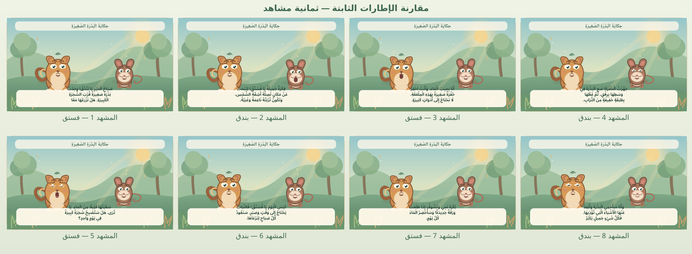
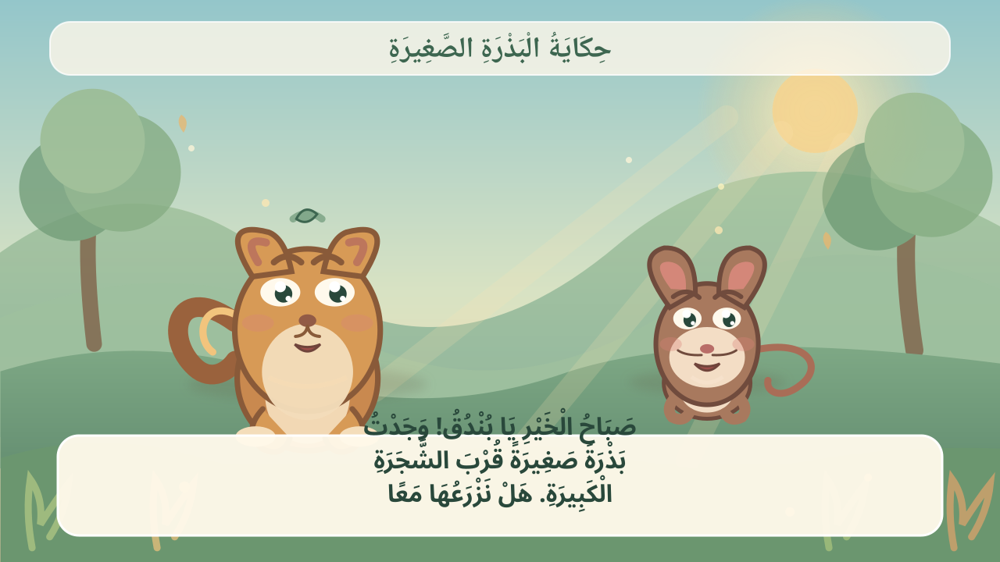
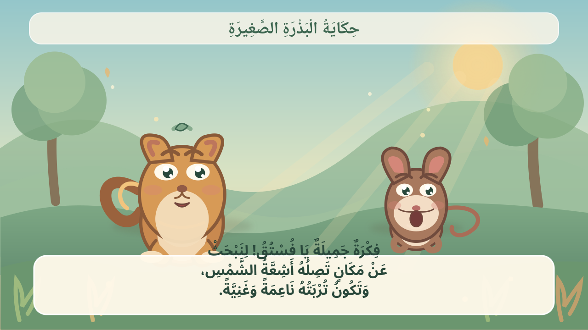
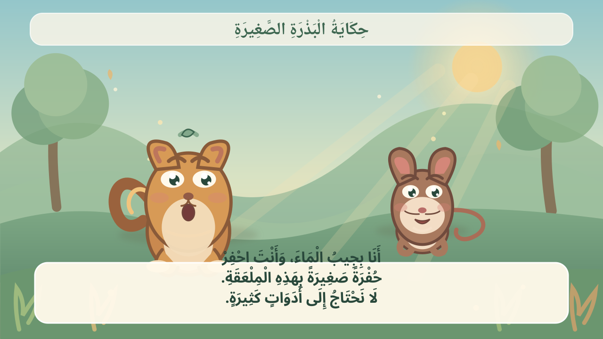
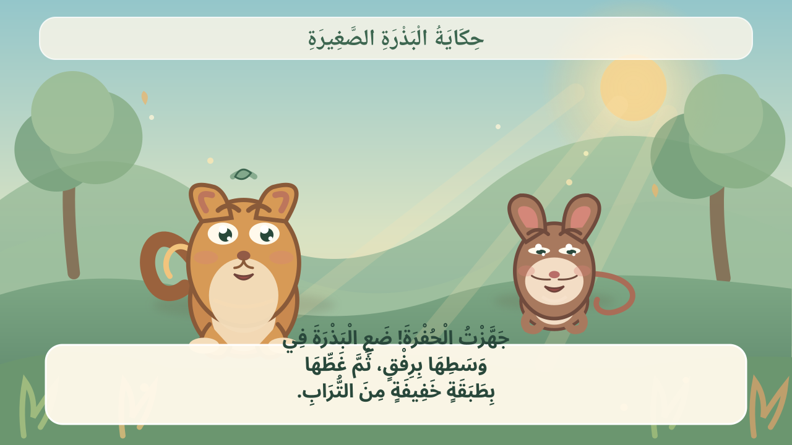
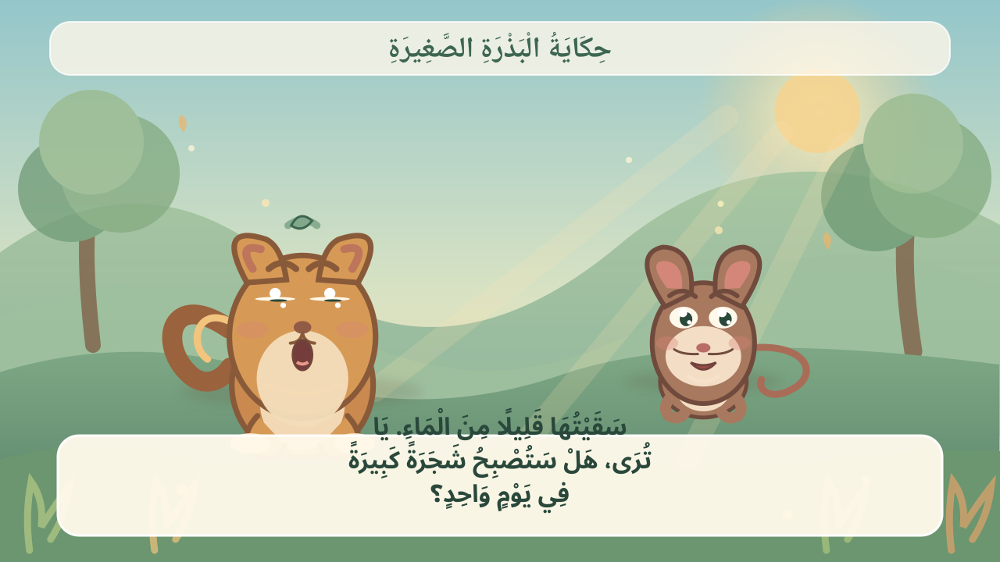
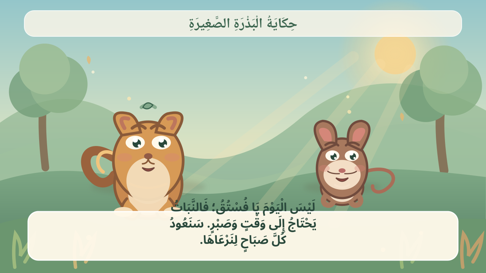
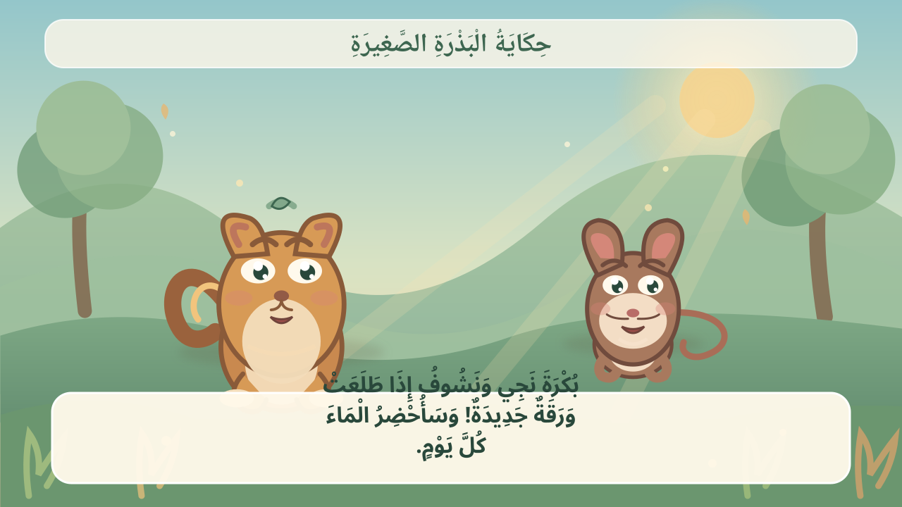
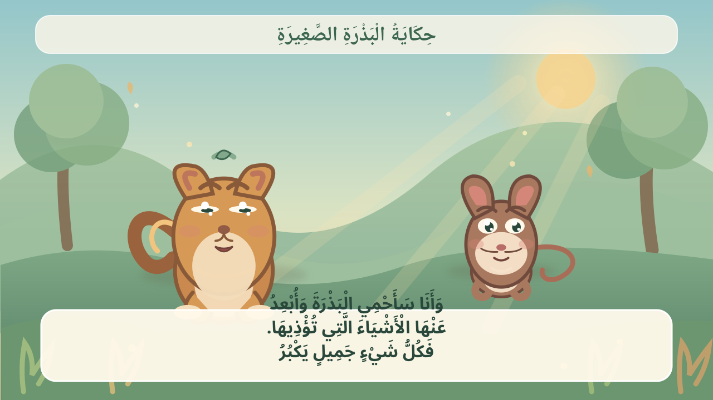

# Character visual review — نسخة شخصيات v1

هذه معاينة ثابتة لكل مشهد من المشاهد الثمانية، مأخوذة من منتصف المقطع الصوتي بعد قياس envelope. كل لوحة تمثل **إطار مراجعة فقط**، وليست مخرجاً نهائياً. تمت كتابة الأشكال والخلفيات بالكود؛ لم تُستخدم أوزان توليد صور.

| المشهد | المتحدث | الإطار |
|---|---|---|
| 1 | فستق |  |
| 2 | بندق |  |
| 3 | فستق |  |
| 4 | بندق |  |
| 5 | فستق |  |
| 6 | بندق |  |
| 7 | فستق |  |
| 8 | بندق |  |

## نقاط مراجعة المالك

- هل قراءة الفرق بين القط والفأر واضحة من silhouette والحجم؟
- هل العيون والفم أكبر/أصغر من المطلوب؟
- هل الخلفية غنية بما يكفي مع بقاء مساحة الترجمة مقروءة؟
- هل حركة الأذن والذيل والارتداد هادئة وغير مشتتة؟

لا تُعتمد هذه الهوية أو الحلقة قبل مراجعة المالك.
